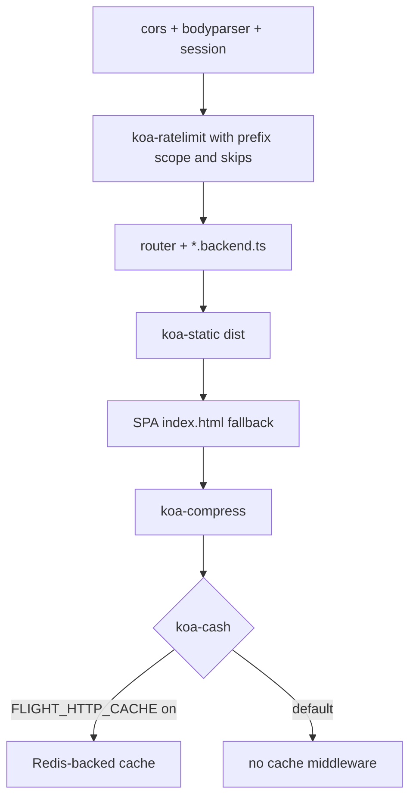

<p align="center">
  
</p>

# Flight

**Flight** is an application server for teams who want something **fast**, **boring in the good way**, and **ready for serious traffic**. You bring your own hosting—there is no lock-in to a proprietary edge or a single vendor’s deployment story. It fits **twelve-factor** style workflows: configuration via environment variables, horizontal scaling, and state kept where it belongs (for Flight, that includes **Redis** for sessions and cache-friendly layers).

Think **platform-agnostic**: not framework-as-a-platform, but a clear runtime you can run wherever **Node** or **Bun** runs—VMs, Kubernetes, bare metal, your cloud of choice. The `flight` binary is the Node / Koa server. `flight-bun` is the Bun server (`Bun.serve`), and it can still mount existing Koa `router.routes()` backends while you move routes over. Flight is aimed at **hyperscale-friendly** designs (cluster workers on Node, a single Bun process with native TypeScript on the Bun path), **ephemeral** processes, and **component-shaped** backends so routes stay colocated with the features they serve. **Vue** and **React** are both supported through the same **Vite** dev and production flows (your app’s **`vite.config`** chooses the UI stack; Flight does not). Vanilla JS/TS, Preact, Lit, Svelte, Solid, and Qwik work the same way and are covered by tests: see [UI frameworks](#ui-frameworks).

Flight is **open source** from **[ThoughtPivot](https://github.com/thoughtpivot)**.

## ⚡ Now on Bun

`flight-bun` runs Flight on `Bun.serve`. On a single pinned core, at the same commit, compared with the Node `flight` binary (hello-route micro-benchmark, measured 2026-10-14 against commit `b0d8689`, before 3.0.1 and 3.0.2):

|                           | Node (`flight`)             | Bun (`flight-bun`) |
| ------------------------- | --------------------------- | ------------------ |
| Req/s, Bun-native route   | 19,651                      | **61,110** (3.1x)  |
| Req/s, existing Koa route | 19,651                      | **38,826** (2.0x)  |
| p99 latency               | 10-25 ms                    | **~3 ms** (native) |
| Start to first response   | 1.18 s (TypeScript via tsx) | **47 ms**          |
| Idle RSS                  | 218 MB (primary + 1 worker) | **27 MB**          |

**What changed:**

- native `Bun.serve` routes
- Bun-native middleware (security headers, CORS, gzip, rate limit, sessions, cache)
- `.backend.ts` loaded directly, with no build step
- Redis is optional and falls back to memory

Existing `export default router.routes()` backends mount unchanged through the Koa-compat layer.

**Note:** `flight-bun` is a single process. `FLIGHT_MAX_WORKERS` and Node's `cluster` module are not used. On 4 cores, a 4-worker Node cluster served more requests (80.7k vs 53.8k req/s), so scale `flight-bun` with replicas. The Bun rate limiter is an in-memory `Map` in that process and does not use Redis. `flight-bun` is configured only through environment variables and ignores Node-style CLI flags such as `--port`. The two sides run their own default middleware, which differs. Method and raw data: https://github.com/thoughtpivot/flight/blob/main/bench/BENCHMARKS.md (scripts in [`bench/`](https://github.com/thoughtpivot/flight/tree/main/bench)).

`flight-bun` (installed package) or `bun src/bun/server.ts` (a clone of this repo)

Early Bun research and benchmarks for Flight and Scribe by Vasilen Lyubomirov ([github.com/VasilenL](https://github.com/VasilenL)), whose work helped start this.

Setup, environment variables and the backend contract: [Bun runtime](#bun-runtime).

#thoughtpivot

## Highlights

- **Two runtimes**: **Node / Koa** (`flight`) and **Bun** (`flight-bun`). The Bun server loads TypeScript directly, exposes `GET /healthz`, and still accepts existing Koa backends
- **Performance-focused**: Cluster mode on Node, compression, Redis-backed caching hooks, rate limiting in production
- **Developer velocity**: **Vite** dev server with HMR on port **3001** for **Vue** or **React** (per your project’s Vite config)
- **Composable backends**: Discover `**/*.backend.ts` (and `**/*.backend.js` on Bun) under your app root and mount them per component
- **Production SPA**: Built-in **`dist` + `index.html`** fallback (option B) when running **`production`** with **`disable_vite`**, with an explicit opt-out for API-only processes
- **Configurable discovery**: `--exclude_paths` / `FLIGHT_EXCLUDE_PATHS` to skip directories when scanning backends
- **TypeScript-native**: Written for TS projects; sensible defaults, minimal ceremony
- **Interop-friendly**: Correct handling of `yargs` when launched via **tsx** or similar loaders (no patch-package needed from **v1.0.8** onward)

## Installation

```bash
npm install @thoughtpivot/flight
# or
yarn add @thoughtpivot/flight
```

Legacy npm scope: the package was previously published as `@spytech/flight`—use `@thoughtpivot/flight` going forward.

### Downstream apps (tsx)

From **v1.0.8** onward, Flight normalizes `require('yargs/yargs')` under loaders that expose `{ default: factory }`. If you added **patch-package** only for that issue, upgrade Flight and drop that patch.

## Quick Start

1. Create a new project directory and initialize:

```bash
mkdir my-flight-app
cd my-flight-app
npm init -y
```

2. Install Flight and its dependencies:

```bash
npm install @thoughtpivot/flight
```

Flight installs `koa`, `@koa/router`, and `ioredis` as dependencies. If your package manager does not hoist them, install `@koa/router` in your app too. For a **React** UI, also install `react`, `react-dom`, and (with TypeScript) `@types/react` / `@types/react-dom` as dev dependencies. For **Vue**, install `vue` and wire **`@vitejs/plugin-vue`** in **`vite.config`**.

3. Ensure Redis is running locally, or point the Node server at yours with `FLIGHT_REDIS_HOST` and `FLIGHT_REDIS_PORT` (see the configuration table). The Node server uses Redis for sessions and rate limiting. Redis is optional on Bun.

4. Create a component with a backend route:

```bash
mkdir -p components/hello
```

Create `components/hello/hello.backend.ts`:

```typescript
import Router from '@koa/router'

const router = new Router()

router.get('/hello', async (ctx) => {
    ctx.body = { message: 'Hello from Flight!' }
})

export default router.routes()
```

5. Add scripts to **`package.json`** (the `flight` binary comes from **`node_modules/.bin`** after install):

```json
{
    "scripts": {
        "dev": "flight --mode development",
        "start": "flight --mode production"
    }
}
```

Use **`FLIGHT_DISABLE_VITE`**, **`FLIGHT_DIST_PATH`**, and related env vars in **`.env`** for production built-assets mode (see the configuration table below). In production, Flight runs **`npx vite build`** at startup unless **`disable_vite`** is true. An API-only project with no `index.html` should set **`FLIGHT_DISABLE_VITE=true`**; otherwise the build fails and logs `exec error` (the server still starts).

6. Start the server:

**Development (Vite on 3001, API on 3000):**

```bash
npx flight --mode development
# or: npm run dev
```

**Production:**

```bash
npx flight --mode production
# or: npm run start
```

**`--app_home`** defaults to **`.`** (the current working directory). Pass **`--app_home path/to/app`** only when your app root is not the directory you run the command from.

**Try without adding a dependency** (downloads the package for this invocation). Use **`--package=@scope/pkg`** (equals form) and a literal **`--`** before the binary name so `npx` does not treat `flight` as a separate package or lose the install’s **`node_modules/.bin`** on your `PATH` (otherwise you can see `sh: flight: command not found`):

```bash
npx --yes --package=@thoughtpivot/flight -- flight --mode development
```

Equivalent:

```bash
npm exec --yes --package=@thoughtpivot/flight -- flight --mode development
```

**Global install** (optional): `npm install -g @thoughtpivot/flight`, then run **`flight`** from your PATH the same way as **`npx flight`**.

**Bun** (same app directory, [Bun](https://bun.sh) 1.x on your PATH):

```bash
# development: API on :3000, Vite on :3001
FLIGHT_MODE=development flight-bun

# production: serve dist/ plus backends
FLIGHT_MODE=production flight-bun
```

From a clone of this repo, that is `bun src/bun/server.ts` (or `npm run start:bun`). Existing `export default router.routes()` files keep working. New files can export a Web `Request` / `Response` route map. Details, env vars, and the backend contract are in [Bun runtime](#bun-runtime).

### Loading `.backend.ts` files on Node

The `flight` binary is compiled JavaScript that `require()`s your `**/*.backend.ts` files, so Node has to be able to read them:

- **Node 22.18 and later** strip TypeScript types by default. No loader is needed. Node does not strip types for files under `node_modules`.
- **Node 20.19 and 22.12 to 22.17** read a `.backend.ts` file as plain JavaScript. The Quick Start example works because it contains no TypeScript-only syntax. A type annotation or `import type` fails at startup with `SyntaxError: Unexpected token`. Install a loader and preload it, for example `npm install -D tsx` and then `NODE_OPTIONS="--require tsx/cjs" npx flight --mode production`. `ts-node` in transpile-only mode also works (`node -r ts-node/register/transpile-only node_modules/.bin/flight`).
- **Bun** runs TypeScript natively and needs no loader.

## Development vs production

The Node server picks **`mode`** as: **`FLIGHT_MODE`** (if set and non-empty), else **`--mode`** from argv, else **`production`**. The table below is that Node / Koa process. It assumes Redis is reachable unless you only use routes that avoid session, rate limit, and cache. The Bun server is documented in [Bun runtime](#bun-runtime).

| Topic            | Development                                                                                              | Production                                                                                                                                  |
| ---------------- | -------------------------------------------------------------------------------------------------------- | ------------------------------------------------------------------------------------------------------------------------------------------- |
| **Vite**         | Child process: `npx vite --port 3001 --host 0.0.0.0` (HMR for **Vue or React**, per your `vite.config`). | If **`disable_vite` is false**: `exec('npx vite build')` is triggered once at worker startup. If **`disable_vite` is true**: no Vite build. |
| **Listen port**  | API + sessions on **`--port`** / `FLIGHT_PORT` (default **3000**). UI dev server on **3001**.            | Same **`--port`** / `FLIGHT_PORT` for the worker.                                                                                           |
| **Static / SPA** | The Vite dev server serves UI; Flight does **not** mount the production static/SPA stack.                | See **Production SPA pipeline** below: when **`production`** + **`disable_vite`**, Flight uses **Option B** by default unless opted out.    |
| **Typical use**  | Local full-stack with HMR.                                                                               | CI-built `dist` served by Flight (or behind a load balancer).                                                                               |

**Edge cases**

- **`production` + `disable_vite` false**: Vite build still runs; **legacy** middleware order applies (`ratelimit` → router → `compress` → `koa-cash` → static), because built-assets-only mode is off.
- **`production` + `disable_vite` true + `FLIGHT_DISABLE_SPA_PIPELINE`**: **Legacy** stack only—no SPA HTML fallback for unknown GETs; tail `koa-static` only after compress/cache.
- **`development`**: unchanged—Redis session store and production-only static/SPA branches do not apply the SPA pipeline section (the dev Vite server owns UI URLs).

## Configuration: CLI, `.env`, and environment variables

Flight loads a **`.env`** file from the **current working directory** at startup (via **`dotenv`**). Use **`FLIGHT_*`** in real deployments.

**Precedence**

- **`mode`**: **`FLIGHT_MODE`** wins over **`--mode`** when the variable is set (non-empty).
- **`disable_vite`**: explicit CLI wins; if omitted, **`FLIGHT_DISABLE_VITE`** (`true` / `1` / `yes` → on); otherwise **`false`**.
- Other settings: argv value if your launcher passes it, else the **`FLIGHT_*`** column, then default.

**Registered CLI options:** Flight registers **`--exclude_paths`**, **`--mode`**, **`--port`**, **`--app_home`**, **`--app_key`**, **`--app_secret`**, **`--payload_limit`**, and **`--disable_vite`** (with kebab-case aliases where listed in `--help`). yargs is not in **strict** mode, so additional flags may still appear on argv if you extend the entrypoint.

| Setting (CLI / argv)                 | Environment variable                 | Default                  | Use case                                                                                                                                                                                                                                                                                                                                                     |
| ------------------------------------ | ------------------------------------ | ------------------------ | ------------------------------------------------------------------------------------------------------------------------------------------------------------------------------------------------------------------------------------------------------------------------------------------------------------------------------------------------------------ |
| `--exclude_paths`, `--exclude-paths` | `FLIGHT_EXCLUDE_PATHS`               | _(empty)_                | Skip subtrees when globbing `**/*.backend.ts` (monorepo vendor trees, fixtures). Nothing is excluded by default, so **`node_modules` is scanned**: a `*.backend.ts` inside a dependency is loaded, and can stop startup. Set `FLIGHT_EXCLUDE_PATHS=node_modules,dist` to skip them. Entries are paths under `app_home`. Bun defaults to `node_modules,dist`. |
| `--app_home`                         | `FLIGHT_APP_HOME`                    | `.`                      | Repository root; `process.chdir` target before discovery and static paths.                                                                                                                                                                                                                                                                                   |
| `--app_key`                          | `FLIGHT_APP_KEY`                     | `flightApp`              | Session cookie name.                                                                                                                                                                                                                                                                                                                                         |
| `--app_secret`                       | `FLIGHT_APP_SECRET`                  | _(built-in placeholder)_ | Cookie signing secret(s); comma-separated for key rotation. The default is a public placeholder string in the source, so **always set this in production**.                                                                                                                                                                                                  |
| _(argv)_                             | `FLIGHT_SESSION_DURATION_MS`         | `86400000`               | Session `maxAge` in ms.                                                                                                                                                                                                                                                                                                                                      |
| `--port`                             | `FLIGHT_PORT`                        | `3000`                   | HTTP listen port (all modes).                                                                                                                                                                                                                                                                                                                                |
| `--payload_limit`                    | `FLIGHT_PAYLOAD_LIMIT`               | `1mb`                    | `koa-bodyparser` JSON limit.                                                                                                                                                                                                                                                                                                                                 |
| `--disable_vite`                     | `FLIGHT_DISABLE_VITE`                | `false`                  | **`true` / `1` / `yes`**: skip `vite build` and treat the process as **built-assets** mode (triggers SPA pipeline rules in production).                                                                                                                                                                                                                      |
| `--mode`                             | `FLIGHT_MODE`                        | `production`             | `development` spawns Vite; `production` enables production middleware.                                                                                                                                                                                                                                                                                       |
| _(n/a)_                              | `FLIGHT_DIST_PATH`                   | `../dist`                | Filesystem root for `koa-static`, resolved from the cwd **after** chdir to `app_home`. The default is the **parent** of `app_home`, so set `FLIGHT_DIST_PATH=dist` when `dist/` sits inside your app. Bun defaults to `<app home>/dist`.                                                                                                                     |
| _(n/a)_                              | `FLIGHT_DISABLE_SPA_PIPELINE`        | _(unset)_                | **`1` / `true` / `yes`**: force **legacy** production stack (no in-router SPA fallback) while keeping `production` + `disable_vite`. Use for **API-only** workers or until duplicate app middleware is removed.                                                                                                                                              |
| _(n/a)_                              | `FLIGHT_STATIC_PREFIXES`             | `/assets,/fonts`         | Baseline URL prefixes for **rate-limit skipping** on `GET`/`HEAD` (static hashed chunks).                                                                                                                                                                                                                                                                    |
| _(n/a)_                              | `FLIGHT_RATE_LIMIT_EXCLUDE_PREFIXES` | _(empty)_                | Extra prefixes merged with `FLIGHT_STATIC_PREFIXES` for the same skip list.                                                                                                                                                                                                                                                                                  |
| _(n/a)_                              | `FLIGHT_RATE_LIMIT_INCLUDE_PREFIXES` | _(empty)_                | Limit **only** paths under these prefixes (comma-separated, for example `/api,/v1`). Empty means the limiter covers **every route**. Flight does not assume `/api`.                                                                                                                                                                                          |
| _(n/a)_                              | `FLIGHT_SPA_INDEX`                   | `index.html`             | SPA shell file inside the dist root for HTML fallback.                                                                                                                                                                                                                                                                                                       |
| _(n/a)_                              | `FLIGHT_SPA_DENY_PREFIXES`           | _(empty)_                | Extra prefixes that never get SPA fallback, merged with `/api` and `/health`. On Bun, setting this **replaces** the default list (`/api,/health,/healthz`).                                                                                                                                                                                                  |
| _(n/a)_                              | `FLIGHT_TRUST_PROXY`                 | `false`                  | **`1` / `true` / `yes`**: set **`app.proxy = true`** so `ctx.ip` follows **`X-Forwarded-For`** behind an L7 LB. The Node rate limiter keys on the `X-Forwarded-For` header whenever it is present, whether or not this is set (see [Rate limiting](#rate-limiting)).                                                                                         |
| _(n/a)_                              | `FLIGHT_HTTP_CACHE`                  | `false`                  | **`1` / `true` / `yes`**: enable **`koa-cash`** in the **SPA pipeline** branch only (off by default there). Legacy branch always attaches `koa-cash`.                                                                                                                                                                                                        |
| _(n/a)_                              | `FLIGHT_REDIS_HOST`                  | `localhost`              | Redis host for sessions and rate limiting (and the cache adapter). Node only: Bun uses `FLIGHT_REDIS_URL`.                                                                                                                                                                                                                                                   |
| _(n/a)_                              | `FLIGHT_REDIS_PORT`                  | `6379`                   | Redis port. Node only.                                                                                                                                                                                                                                                                                                                                       |
| _(n/a)_                              | `FLIGHT_MAX_WORKERS`                 | CPU count                | Cap the cluster worker count on small nodes. It cannot raise the count above the number of CPUs. Node only: Bun is a single process.                                                                                                                                                                                                                         |

`1`, `true`, and `yes` are matched exactly. `TRUE` does not turn those settings on.

**Node-only settings.** `FLIGHT_APP_KEY`, `FLIGHT_APP_SECRET`, `FLIGHT_SESSION_DURATION_MS`, `FLIGHT_DISABLE_VITE`, `FLIGHT_DISABLE_SPA_PIPELINE`, `FLIGHT_SPA_INDEX`, `FLIGHT_HTTP_CACHE`, `FLIGHT_REDIS_HOST`, `FLIGHT_REDIS_PORT`, `FLIGHT_MAX_WORKERS`, and the CLI flags above are read only by the `flight` binary. The Node server has a fixed rate limit of 1200 requests per client per 60 seconds, 24-hour sessions unless `FLIGHT_SESSION_DURATION_MS` is set, and always logs requests with `koa-logger`. `flight-bun` reads its own set of variables, listed under [Bun runtime](#bun-runtime). Both runtimes read `FLIGHT_MODE`, `FLIGHT_PORT`, `FLIGHT_APP_HOME`, `FLIGHT_DIST_PATH`, `FLIGHT_EXCLUDE_PATHS`, `FLIGHT_PAYLOAD_LIMIT`, `FLIGHT_SPA_DENY_PREFIXES`, `FLIGHT_STATIC_PREFIXES`, `FLIGHT_TRUST_PROXY`, and the `FLIGHT_RATE_LIMIT_*_PREFIXES` variables.

Example `.env` fragment:

```bash
FLIGHT_MODE=development
FLIGHT_APP_HOME=.
FLIGHT_REDIS_HOST=127.0.0.1
FLIGHT_REDIS_PORT=6379
FLIGHT_PORT=3000
FLIGHT_MAX_WORKERS=4
```

Production behind a proxy:

```bash
FLIGHT_MODE=production
FLIGHT_DISABLE_VITE=true
FLIGHT_TRUST_PROXY=1
```

## Project Structure

```
my-app/
├── components/
│   └── hello/
│       ├── Index.vue          # Vue UI (example)
│       └── Index.backend.ts   # Koa routes for this component
├── assets/
├── dist/                      # Production build output
└── package.json
```

Example Vue + backend snippets:

`components/hello/Index.vue`:

```vue
<template>
    <div>
        <h1>{{ message }}</h1>
    </div>
</template>

<script setup lang="ts">
import { ref } from 'vue'

const message = ref('Hello from Flight!')
</script>
```

`components/hello/Index.backend.ts`:

```typescript
import Router from '@koa/router'

const router = new Router()

router.get('/hello', async (ctx) => {
    ctx.body = { message: 'Hello from Flight!' }
})

export default router.routes()
```

## React + Vite (same Flight commands)

Flight does **not** choose Vue vs React—it runs **`vite`** / **`vite build`** from your **`app_home`**; your **`vite.config.*`** and app **`package.json`** select the framework. The `@thoughtpivot/flight` package includes **`@vitejs/plugin-react`** alongside **`@vitejs/plugin-vue`** so React+Vite apps get the same style of transitive plugin coverage as Vue apps. You still install the UI runtime in **your** app. Flight ships **Vite 8** and matching plugins; apps that stay on Vite 6 should pin **`@thoughtpivot/flight@2.0.2`** until they upgrade.

```bash
npm install react react-dom
npm install -D @types/react @types/react-dom
```

Set **`"type": "module"`** in the app **`package.json`** (or use a `.mts` / `.mjs` Vite config) so Vite 8 loads ESM config without falling back to the deprecated CommonJS path.

`vite.config.ts` (project root):

```typescript
import { defineConfig } from 'vite'
import react from '@vitejs/plugin-react'

export default defineConfig({
    plugins: [react()]
})
```

`index.html`:

```html
<!doctype html>
<html lang="en">
    <head>
        <meta charset="UTF-8" />
        <meta name="viewport" content="width=device-width, initial-scale=1.0" />
        <title>Flight + React</title>
    </head>
    <body>
        <div id="root"></div>
        <script type="module" src="/src/main.tsx"></script>
    </body>
</html>
```

`src/main.tsx`:

```tsx
import { StrictMode } from 'react'
import { createRoot } from 'react-dom/client'
import App from './App'

createRoot(document.getElementById('root')!).render(
    <StrictMode>
        <App />
    </StrictMode>
)
```

`src/App.tsx`:

```tsx
export default function App() {
    return <h1>Hello from Flight + React</h1>
}
```

Use the same **`npx flight --mode development`** / **`--mode production`** flow as Vue. Production **`dist`**, **`FLIGHT_DISABLE_VITE`**, and the **Production SPA pipeline** behave the same for a Vite-built React SPA.

## UI frameworks

Flight does not choose a UI framework. It runs **`vite`** and **`vite build`** from your **`app_home`**, and your **`vite.config.*`** decides what builds. Flight 3 ships **Vite 8**, so a framework needs a plugin version that supports Vite 8. Vue and React are covered above. These six are covered by tests:

| Framework                 | Install                                           | What it needs                                                   |
| ------------------------- | ------------------------------------------------- | --------------------------------------------------------------- |
| Vanilla JavaScript and TS | nothing                                           | Nothing. No plugin and no config.                               |
| Preact                    | `preact`                                          | A tsconfig with `jsxImportSource: "preact"`. No plugin.         |
| Lit                       | `lit`                                             | Plain classes: nothing. Decorators: `experimentalDecorators`.   |
| Svelte                    | `svelte` `@sveltejs/vite-plugin-svelte`           | The plugin in `vite.config`.                                    |
| Solid                     | `solid-js` `vite-plugin-solid`                    | The plugin in `vite.config`.                                    |
| Qwik                      | `@qwik.dev/core` (Qwik 2, tested at `2.0.0-rc.5`) | `qwikVite({ csr: true })` in an ESM config (`vite.config.mts`). |

Each framework has a minimal app in [`test/frameworks/fixtures/`](test/frameworks/fixtures). `npm run test:frameworks` starts the Node server on each one, lets Flight run `vite build`, and checks the page and its bundle. It then loads the page in headless Chrome and requires the expected markup with no console errors, page errors, failed requests, or HTTP error responses. It repeats the check against `flight-bun` serving the same build. CI runs it on every pull request. The tests cover the production build and serve path. They do not start the Vite dev server.

**Vanilla JavaScript and TypeScript.** Point `index.html` at a module script, for example `<script type="module" src="/src/main.ts">`. Vite compiles TypeScript, and plain `.js` modules can be imported alongside it.

**Preact.** Add a `tsconfig.json` so Vite compiles JSX for Preact:

```json
{ "compilerOptions": { "jsx": "react-jsx", "jsxImportSource": "preact" } }
```

No Vite plugin is required for a build. Without `jsxImportSource` the build succeeds but the page does not render the component. `@preact/preset-vite` is optional and adds fast refresh in development; the fixture does not use it.

**Lit.** Plain classes (`static properties` and `customElements.define`) need no configuration. For decorators (`@customElement`, `@property`), add a tsconfig with `"experimentalDecorators": true`, and `"useDefineForClassFields": false` as Lit recommends. Without `experimentalDecorators` the build still succeeds, but the page throws `Invalid or unexpected token` in the browser.

**Svelte.** Install Svelte 5 and the plugin, then register it:

```typescript
import { svelte } from '@sveltejs/vite-plugin-svelte'

export default { plugins: [svelte()] }
```

`<script lang="ts">` works without a `svelte.config.js`.

**Solid.** `vite-plugin-solid` compiles Solid's JSX:

```typescript
import solid from 'vite-plugin-solid'

export default { plugins: [solid()] }
```

No tsconfig is needed for the build. Add one with `"jsx": "preserve"` and `"jsxImportSource": "solid-js"` for editor types.

**Qwik.** Use Qwik 2 (`@qwik.dev/core`), which targets Vite 8. It is currently a release candidate on npm. Flight serves static files, so build Qwik in client-only mode:

```typescript
import { qwikVite } from '@qwik.dev/core/optimizer'

export default { plugins: [qwikVite({ csr: true })] }
```

- **`csr: true` is required.** Qwik's default config expects a server-rendered layout and fails with `Qwik input .../src/root not found`.
- **The config must be ESM.** Name it `vite.config.mts`, or set `"type": "module"` in your `package.json`. As `vite.config.ts` in a CommonJS package, Vite fails with `This package is ESM only but it was tried to load by require`.
- **Qwik 1.x** (`@builder.io/qwik`) declares `vite >=5 <8`. In an app that does not depend on `vite` itself, npm installs Vite 7 at the app root for Qwik and keeps Flight's Vite 8 nested, so Flight's `npx vite build` runs on **Vite 7**. A manual check of Flight building and serving a Qwik 1 app that way worked. If your app pins Vite 8, npm stops with `ERESOLVE` unless you add `"overrides": { "@builder.io/qwik": { "vite": "$vite" } }` to your `package.json`. Qwik 1 is not part of the automated tests.

## Development mode

- **Vite** with HMR on port **3001** for **Vue or React** (whatever your `vite.config` configures)
- Backend worker on **`--port`** (default **3000**)
- Request logging via **`koa-logger`**

## Production mode

- Optional **`npx vite build`** before serving static assets when **`disable_vite`** is **false**
- Cluster workers capped by **`FLIGHT_MAX_WORKERS`**
- Compression + Redis-backed rate limiting in all production configurations
- Static dist + SPA behavior depends on **built-assets mode**—see next section

## Production SPA pipeline (v2)

**When it is on (option B):** `mode === 'production'` **and** **`disable_vite === true`** **and** **`FLIGHT_DISABLE_SPA_PIPELINE` is not truthy.**

**What it does:** After your **`router`** (all `**/*.backend.ts` routes), Flight serves **`FLIGHT_DIST_PATH`** with **`koa-static`**, then applies an **`index.html`** fallback for typical browser navigations (see tests in `src/spa-pipeline.test.ts` for the behavioral contract). Then it runs **`koa-compress`**, and optionally **`koa-cash`** when **`FLIGHT_HTTP_CACHE`** is enabled. The Redis **`koa-ratelimit`** limiter is mounted **before** the router, so it counts every request, including requests your router answers. See [Rate limiting](#rate-limiting).

**Path ownership**

- **API / BFF:** Implement on your `Router` in `*.backend.ts` under prefixes you own (conventionally **`/api/...`**). Those paths are excluded from the SPA fallback, along with **`/health`** and any **`FLIGHT_SPA_DENY_PREFIXES`**.
- **Static:** Any file present under the dist root is served by **`koa-static`** first.
- **SPA:** Remaining **`GET`/`HEAD`** requests that look like document navigations and whose last path segment has **no dot** (so `file.ext` URLs are not rewritten) may receive **`FLIGHT_SPA_INDEX`**.

**Load balancers and `X-Forwarded-For`**

- Set **`FLIGHT_TRUST_PROXY=1`** when Flight sits behind a trusted reverse proxy so **`ctx.ip`** reflects the client. Configure your proxy to overwrite or append **one** well-formed **`X-Forwarded-For`** chain. The Node rate limiter identifies a client by the whole `X-Forwarded-For` header value when the request has one, and by `ctx.ip` otherwise. It does not look at `FLIGHT_TRUST_PROXY`, so a proxy must set that header, or a client can send its own and choose its own rate-limit bucket.
- Sessions use cookies (`sameSite: true` in code today); sticky sessions or shared Redis are operational choices outside Flight’s defaults.

### Middleware order (mermaid)

**SPA pipeline (default when production + `disable_vite`):**



**Legacy production stack** (`disable_vite` false, or **`FLIGHT_DISABLE_SPA_PIPELINE`** set): **`ratelimit`** → `router` → **`compress`** → **`koa-cash`** → **`koa-static`**.

### Rate limiting

The Node limiter is a production-only, Redis-backed **`koa-ratelimit`**. The limit is fixed at 1200 requests per client per 60 seconds and has no environment variable. Counters live in Redis, so cluster workers and replicas that share a Redis share a window. Responses carry `Rate-Limit-Total`, `Rate-Limit-Remaining`, and `Rate-Limit-Reset` headers, and a request over the limit gets `429` with `Retry-After` and the body `Sometimes You Just Have to Slow Down.` The limiter is mounted before the router, so it covers every request, including requests that your routes answer. A client is identified by its `X-Forwarded-For` header when present, otherwise by `ctx.ip`.

**By default the limiter applies to every route.** Flight does not assume an `/api` prefix. Two environment variables change the scope. Both take comma-separated URL path prefixes:

| Variable                             | Default          | Effect                                                                                                                                                       |
| ------------------------------------ | ---------------- | ------------------------------------------------------------------------------------------------------------------------------------------------------------ |
| `FLIGHT_RATE_LIMIT_INCLUDE_PREFIXES` | _(empty)_        | Limit only paths equal to or under these prefixes. Empty limits every route. For example, `/api` limits `/api` and `/api/orders` and leaves `/orders` alone. |
| `FLIGHT_RATE_LIMIT_EXCLUDE_PREFIXES` | _(empty)_        | `GET` and `HEAD` under these prefixes (merged with `FLIGHT_STATIC_PREFIXES`) are never counted. Applies to the SPA pipeline.                                 |
| `FLIGHT_STATIC_PREFIXES`             | `/assets,/fonts` | `GET` and `HEAD` under these prefixes are never counted, so hashed static files do not use the budget. Applies to the SPA pipeline.                          |

When an include list is set, the exclude and static lists still apply to the paths inside it. Counters are shared across cluster workers through Redis.

Before 3.0.2 the limiter was mounted after the router, in every tagged release back to 1.0.7. Routes your router answered, including every `/api` route, were never counted, and only unmatched requests were. From 3.0.2 they are counted and get a `429` once the limit is exceeded. See [Upgrading to 3.x](#upgrading-to-3x).

### Migrating from Flight 1.x

1. If you rely on the **old** order (everything after `router` saw compress/cache **before** static), set **`FLIGHT_DISABLE_SPA_PIPELINE=1`** until you validate the new behavior. The rate limiter now runs before the router in both stacks.
2. If your app already shipped **custom SPA / history fallback** middleware in `*.backend.ts`, remove the duplicate once you confirm Flight’s fallback matches your routes (especially non-`/api` prefixes—use **`FLIGHT_SPA_DENY_PREFIXES`**).
3. Expect **`koa-cash` off** in the SPA pipeline unless you opt in with **`FLIGHT_HTTP_CACHE`**.

See **[CHANGELOG.md](CHANGELOG.md)** for the full **2.0.0** notes.

### Upgrading to 3.x

Full notes are in **[CHANGELOG.md](CHANGELOG.md)**. What to check, in order:

**From 2.x to 3.0.0**

- **Node.js** `^20.19.0` or `>=22.12.0` (older Node versions are no longer supported).
- **Vite 8.** Flight ships `vite` `^8.3.2` with `@vitejs/plugin-react` 6, `@vitejs/plugin-vue` 6, and `vite-plugin-vuetify` 2. Apps that still use Vite 6 should stay on `@thoughtpivot/flight@2.0.2` until they upgrade. Set `"type": "module"` in your app, or use a `.mts` Vite config.
- **`ioredis` 6.** This matters if your own code creates an `ioredis` client: ioredis 6 needs Node 20 and, per the 3.0.0 changelog, speaks RESP3 by default, so set `protocol: 2` on your client if its server needs the older protocol. Flight's own client takes only `FLIGHT_REDIS_HOST` and `FLIGHT_REDIS_PORT`.
- **New:** the Bun runtime (`flight-bun`), described below.

**3.0.1**

- Koa streaming and server-sent events work on `flight-bun`, and `FLIGHT_IDLE_TIMEOUT` exists. See [Streaming and server-sent events](#bun-runtime).
- The package license changed from **MIT** (3.0.0 and earlier) to **Apache-2.0**. See [LICENSE](LICENSE) and [NOTICE](NOTICE).

**3.0.2: the Node rate limiter now covers matched routes**

- The limiter used to run after the router, so only unmatched requests were counted and matched routes were never limited. It now runs **before** the router in both production stacks. Behavior you may notice after upgrading:
    - A client above 1200 requests per minute on routes your router answers, `/api` routes included, now gets `429`.
    - Static files and SPA pages outside `FLIGHT_STATIC_PREFIXES` (for example `/favicon.ico` or a deep link) count against the same budget. `GET` and `HEAD` under `FLIGHT_STATIC_PREFIXES` and `FLIGHT_RATE_LIMIT_EXCLUDE_PREFIXES` stay exempt.
    - The limit itself is not configurable on Node. To keep some routes unlimited, scope the limiter with `FLIGHT_RATE_LIMIT_INCLUDE_PREFIXES`. Its default, empty, limits every route. Flight does not assume `/api`.
- `flight-bun` was not affected: its limiter always wrapped every route. It also accepts `FLIGHT_RATE_LIMIT_INCLUDE_PREFIXES`.

## Bun runtime

`flight-bun` is the Bun entry. `npx flight` remains the Node server. From an installed package:

```bash
FLIGHT_MODE=development flight-bun
```

From a clone of this repo:

```bash
FLIGHT_MODE=development bun src/bun/server.ts
```

`npm run test:bun` runs the Bun suite and `npm test` runs the Node suite. The Bun suite expects Redis on `127.0.0.1:6379` for its session test (CI provides it).

`flight-bun` is configured only through environment variables. It does not read the Node CLI flags (`--mode`, `--port`, and so on). On Bun, a `.env` file in the working directory is loaded by Bun itself, not by Flight.

The Bun server uses `Bun.serve` and loads TypeScript directly. It exposes `GET /healthz` and the same edge jobs as the Node server (logging, security headers, CORS, gzip, rate limit, sessions, response cache) without Koa packages on the native path. Redis is optional (`FLIGHT_REDIS_URL`); without it, sessions and cache use memory.

**What does not carry over from the Node server**

- **Cluster and `FLIGHT_MAX_WORKERS`.** The Node server forks workers up to `FLIGHT_MAX_WORKERS` (default: one per CPU). `flight-bun` does not read that variable and does not use Node's `cluster` module. It is one process. Use more replicas to fill more cores.
- **Rate-limit storage.** The Bun limiter keeps counters in a process-local `Map`. It does not use Redis, including when `FLIGHT_REDIS_URL` is set. That URL is for sessions and the response cache. Replicas do not share a window, so a limit of 100 across four processes allows 400 requests in the window. The Node production limiter is Redis-backed.

**Streaming and server-sent events**

Koa routes can stream. Set `ctx.respond = false`, send the status line with `writeHead` (for example `content-type: text/event-stream`), and write chunks with `ctx.res.write`. `flight-bun` returns that body as a `ReadableStream` as soon as the stream starts, instead of waiting for `res.end()`. Gzip skips `text/event-stream` and any other body that is still streaming. A client disconnect emits `close` on `ctx.res`; stop heartbeats and drop subscribers there. Set the headers and the first write before the first `await` so they are on the response that is already in flight.

`FLIGHT_IDLE_TIMEOUT` is the `Bun.serve` idle timeout in seconds. The default is `10`, the same as Bun. An explicit `0` disables it. Positive fractions round up to at least `1` (`0.5` becomes `1`). Negative values and values that are not numbers use the default `10`. Values above `255` are clamped to Bun's maximum. Event-stream responses call `server.timeout(req, 0)` so a heartbeat slower than the idle timeout stays connected.

**Two backend contracts can be mixed in one app.**

Bun-native files default-export a path map. Handlers are `(req: Request) => Response`. Path params use Bun's `:id` routes.

```typescript
export default {
    '/api/hello': {
        GET: () => Response.json({ message: 'Hello from Flight!' })
    }
}
```

Existing Koa files keep working. `export default router.routes()` is mounted through Koa, including JSON body parsing. That is the on-ramp: boot the app on Bun, then rewrite routes file by file. `*.backend.js` is discovered as well as `*.backend.ts`.

In development (`FLIGHT_MODE=development`) the API stays on `FLIGHT_PORT` (default 3000) and Vite is spawned on 3001. In production the built SPA is read from `FLIGHT_DIST_PATH` (default `<app home>/dist`) with an `index.html` fallback. `/api`, `/health`, and `/healthz` do not fall back.

**Bun environment variables.** Every variable `flight-bun` reads:

| Variable                             | Default                                  | Effect                                                                                                                                                                                            |
| ------------------------------------ | ---------------------------------------- | ------------------------------------------------------------------------------------------------------------------------------------------------------------------------------------------------- |
| `FLIGHT_MODE`                        | `production`                             | `development` spawns Vite on 3001 (`bunx vite`). `production` serves the built SPA.                                                                                                               |
| `FLIGHT_PORT`                        | `3000`                                   | HTTP listen port.                                                                                                                                                                                 |
| `FLIGHT_HOSTNAME`                    | `0.0.0.0`                                | Interface to bind. Bun only.                                                                                                                                                                      |
| `FLIGHT_APP_HOME`                    | `.`                                      | App root scanned for `*.backend.ts` and `*.backend.js`.                                                                                                                                           |
| `FLIGHT_DIST_PATH`                   | `<app home>/dist`                        | Built SPA root (production).                                                                                                                                                                      |
| `FLIGHT_EXCLUDE_PATHS`               | `node_modules,dist`                      | Top-level directories under the app root to skip during discovery. Setting it **replaces** the default list, and only the first path segment is matched.                                          |
| `FLIGHT_SPA_DENY_PREFIXES`           | `/api,/health,/healthz`                  | Prefixes that never get the SPA fallback. Setting it **replaces** the default list, so include `/api` again if you still want it.                                                                 |
| `FLIGHT_PAYLOAD_LIMIT`               | `1mb`                                    | `koa-bodyparser` JSON limit for Koa backends. Bun-native handlers read the body themselves.                                                                                                       |
| `FLIGHT_LOGGING`                     | `false` (`true` in development)          | Log `METHOD path status ms` for each request.                                                                                                                                                     |
| `FLIGHT_IDLE_TIMEOUT`                | `10`                                     | Idle seconds before Bun closes a socket. Explicit `0` disables it. Fractions round up to at least 1. Negative or invalid values use `10`. Above `255` is clamped. SSE turns this off per request. |
| `FLIGHT_REDIS_URL`                   | unset                                    | `redis://host:6379` for shared sessions and cache. Unset means in-memory stores. The rate limiter never uses Redis.                                                                               |
| `FLIGHT_CORS_ENABLED`                | `true`                                   | CORS headers and `OPTIONS` preflight.                                                                                                                                                             |
| `FLIGHT_CORS_ORIGIN`                 | `*`                                      | `Access-Control-Allow-Origin`. With credentials on and `*`, the request origin is echoed.                                                                                                         |
| `FLIGHT_CORS_METHODS`                | `GET,HEAD,POST,PUT,PATCH,DELETE,OPTIONS` | `Access-Control-Allow-Methods`.                                                                                                                                                                   |
| `FLIGHT_CORS_HEADERS`                | _(empty)_                                | `Access-Control-Allow-Headers`. Empty echoes the request's `Access-Control-Request-Headers`, or `*`.                                                                                              |
| `FLIGHT_CORS_CREDENTIALS`            | `false`                                  | Send `Access-Control-Allow-Credentials: true`.                                                                                                                                                    |
| `FLIGHT_CORS_MAX_AGE`                | `86400`                                  | `Access-Control-Max-Age` seconds.                                                                                                                                                                 |
| `FLIGHT_SECURITY_ENABLED`            | `true`                                   | Helmet-style security headers. No `Content-Security-Policy` is set because a wrong policy breaks the SPA.                                                                                         |
| `FLIGHT_HSTS`                        | `false`                                  | Add `Strict-Transport-Security` (with `includeSubDomains`).                                                                                                                                       |
| `FLIGHT_HSTS_MAX_AGE`                | `15552000`                               | HSTS `max-age` in seconds.                                                                                                                                                                        |
| `FLIGHT_COMPRESS_ENABLED`            | `true`                                   | Gzip text and JSON responses. Event streams and other streaming bodies are never compressed.                                                                                                      |
| `FLIGHT_COMPRESS_THRESHOLD`          | `1024`                                   | Smallest body, in bytes, that is gzipped.                                                                                                                                                         |
| `FLIGHT_RATE_LIMIT_MAX`              | `0`                                      | Requests allowed per client per window. The limiter stays **off** until this is greater than zero.                                                                                                |
| `FLIGHT_RATE_LIMIT_DISABLE`          | `false`                                  | `1` / `true` / `yes` turns the limiter off even when `FLIGHT_RATE_LIMIT_MAX` is set.                                                                                                              |
| `FLIGHT_RATE_LIMIT_DURATION_MS`      | `60000`                                  | Window length in milliseconds.                                                                                                                                                                    |
| `FLIGHT_RATE_LIMIT_INCLUDE_PREFIXES` | _(empty)_                                | Limit only paths under these prefixes. Empty limits every route, Bun-native and Koa. Flight does not assume `/api`.                                                                               |
| `FLIGHT_RATE_LIMIT_EXCLUDE_PREFIXES` | _(empty)_                                | Extra prefixes, merged with `FLIGHT_STATIC_PREFIXES`, whose `GET` and `HEAD` requests are never counted.                                                                                          |
| `FLIGHT_STATIC_PREFIXES`             | `/assets,/fonts`                         | `GET` and `HEAD` under these prefixes skip the rate limit.                                                                                                                                        |
| `FLIGHT_TRUST_PROXY`                 | `false`                                  | When `1` / `true` / `yes`, the limiter identifies clients by `X-Forwarded-For` (first entry), then `X-Real-IP`. Otherwise those headers are ignored and the peer address is used.                 |
| `FLIGHT_SESSION_SECRET`              | unset                                    | Sessions stay **off** until this is set. There is no baked-in secret.                                                                                                                             |
| `FLIGHT_SESSION_COOKIE`              | `flight.sid`                             | Session cookie name (the Node server uses `FLIGHT_APP_KEY`, default `flightApp`).                                                                                                                 |
| `FLIGHT_SESSION_TTL`                 | `86400`                                  | Session lifetime in **seconds** (the Node server uses `FLIGHT_SESSION_DURATION_MS`, in milliseconds).                                                                                             |
| `FLIGHT_CACHE_ENABLED`               | `false`                                  | Cache `GET` responses that send `Cache-Control: max-age`.                                                                                                                                         |
| `FLIGHT_CACHE_MAX_TTL`               | `3600`                                   | Longest time, in seconds, a response is cached whatever its `max-age`.                                                                                                                            |

The Bun limiter sits in front of every route by default. A request over the limit gets `429` with `Retry-After`, and every counted response carries `X-RateLimit-Limit`, `X-RateLimit-Remaining`, and `X-RateLimit-Reset`.

`GET /healthz` returns `ok`. It is answered before the other middleware, so it is not rate limited and carries no security, CORS, or compression handling. The Node server has no `/healthz` route. `FLIGHT_MAX_WORKERS` does not apply on Bun: see the cluster note above.

## Requirements

- Node.js **`^20.19.0` or `>=22.12.0`** (the `flight` binary; matches Vite 8 / ioredis 6)
- [Bun](https://bun.sh) 1.x (only for `flight-bun` / `npm run test:bun`). CI runs Bun 1.4.3, and 1.4.2 has been run against the suite too.
- **Redis** (sessions, rate limit, and cache on the Node server, reached through `FLIGHT_REDIS_HOST` / `FLIGHT_REDIS_PORT`; optional on the Bun runtime, through `FLIGHT_REDIS_URL`, and never used by the Bun rate limiter)
- **TypeScript** in your app if you author `.backend.ts` modules as TS. On Node older than 22.18, also a loader such as `tsx` (see [Loading `.backend.ts` files on Node](#loading-backendts-files-on-node)). Bun needs none.

## CI and npm publish

GitHub Actions is the only CI/publish path:

| Workflow                                                         | When                                                     | What it does                                                                                                                                                                                               |
| ---------------------------------------------------------------- | -------------------------------------------------------- | ---------------------------------------------------------------------------------------------------------------------------------------------------------------------------------------------------------- |
| [`.github/workflows/ci.yml`](.github/workflows/ci.yml)           | Pull requests and pushes to `main`                       | `npm ci`, `lint:check`, `npm test` on Node 20 and 22, `npm run test:bun` on Bun 1.4.3 with a Redis 7 service, and `npm run test:frameworks` (the framework fixtures in headless Chrome) with Redis and Bun |
| [`.github/workflows/publish.yml`](.github/workflows/publish.yml) | GitHub Release published (or manual `workflow_dispatch`) | On Node 22.14 with npm 11.5 or newer: `npm ci`, `lint:check`, `npm test`, a check that the release tag matches `package.json`, then `npm publish --access public --provenance`                             |

### One-time npm setup (Trusted Publishing)

Preferred: no long-lived npm token in GitHub.

1. Sign in at [npmjs.com](https://www.npmjs.com/) as a maintainer of `@thoughtpivot/flight`.
2. Open the package → **Settings** → **Trusted Publisher**.
3. Add GitHub Actions with:
    - **Organization / user:** `thoughtpivot`
    - **Repository:** `flight`
    - **Workflow filename:** `publish.yml`
    - **Environment name:** `npm` (must match the workflow `environment:`)
4. In the GitHub repo, create an **Environment** named `npm` (Settings → Environments). Optional: require reviewers before publish.

There is no token fallback. The publish step unsets `NODE_AUTH_TOKEN` and strips any `_authToken` from the npm config, because a classic or granular token overrides OIDC and fails with `EOTP`. An `NPM_TOKEN` secret is ignored. If publishing breaks, check the Trusted Publisher settings above. The publish job does not run the Bun suite; CI does that on every pull request.

### Cut a release

1. Land the version bump on `main` (`package.json` + `CHANGELOG.md`).
2. Create a GitHub Release whose tag is `v` + that version (example: package `3.0.0` → tag `v3.0.0`).
3. Publishing the release runs `.github/workflows/publish.yml`. The job fails if the tag and `package.json` version disagree.

Dry-run without publishing: Actions → **Publish** → **Run workflow** → leave **dry_run** checked.

Only a published GitHub Release, or a manual run with **dry_run** unchecked, publishes to npm. Merging to `main`, docs-only changes included, never does. `README.md` and `CHANGELOG.md` ship in the package, so documentation changes reach npmjs.com with the next release.

## License

Apache-2.0. See [LICENSE](LICENSE) and [NOTICE](NOTICE).

## Contributing

Issues and pull requests are welcome. Flight improves fastest with real workloads—if you hit an edge case, open an issue with a minimal repro. Run `npm test` and `npm run lint:check` before opening a PR, and `npm run test:bun` as well when you touch `src/bun` (it needs Bun and a Redis on `127.0.0.1:6379`). `npm run test:frameworks` builds and loads the framework fixtures. It needs Node 22.18 or newer (it runs TypeScript test files directly), Bun, Redis, and Chrome or Chromium. Set `FLIGHT_TEST_CHROME` to the browser path if it is not in a standard location.

## Acknowledgments

**Flight** succeeds **[Avian](https://github.com/ispyhumanfly/avian)**—the component-oriented Node server that helped prove this programming model. **Dan Stevenson** created Avian and carried it into **FlyPaper Technologies**, where **Nick Fredericks**, Dan, and the FlyPaper team sharpened Avian’s component boundaries and pushed its operational story. Dan continued to maintain Avian while **Flight** took shape to embrace newer tooling and a cleaner baseline for the next decade.

Today **Flight** is maintained by the **ThoughtPivot** engineering team and **contributors like you**—the same spirit of openness and iteration, with a hard focus on speed, clarity, and deployment flexibility.
